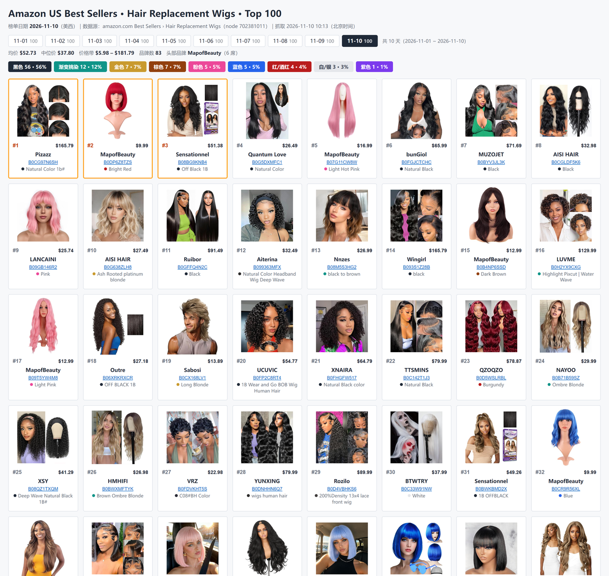
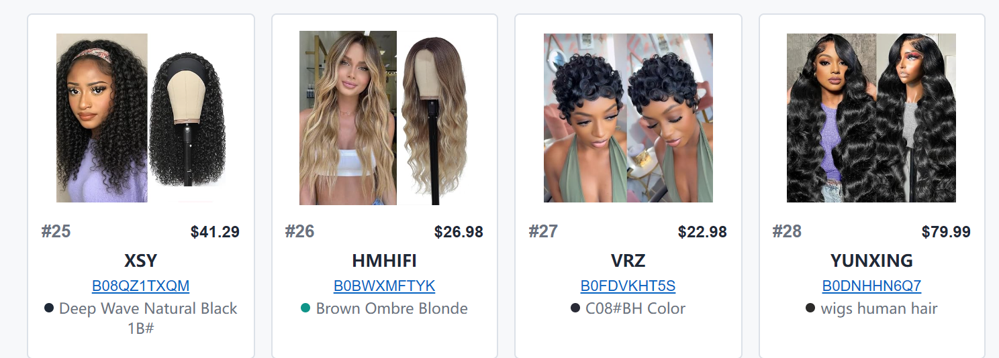
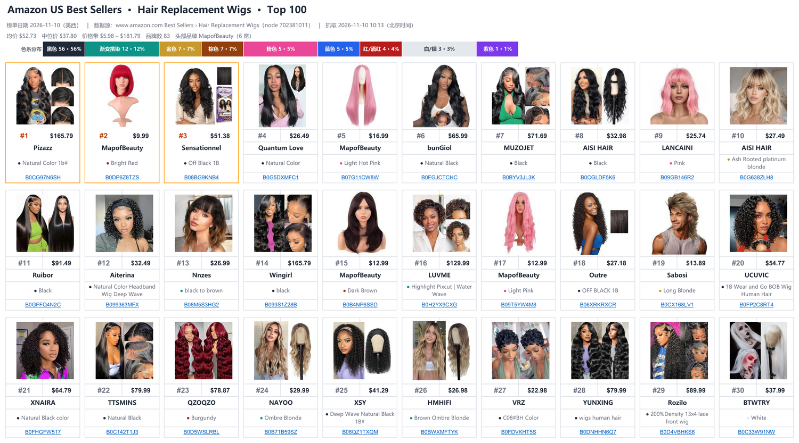

# 亚马逊 BSR 看板 · amazon-bsr-board

**把亚马逊类目榜单前 N 名（默认 100）抓成「能直接看的卡片看板」，一天一页、一月一册，长期积累成排名与颜色的时间序列。**

榜单页通篇只有排名、标题和价格。真正决定要不要跟的是另外几件事：这个位置是哪个品牌在守、
卖多少钱、什么颜色在起量、新品有没有冲进来。所以这个工具会把榜单页缺的信息（品牌、售价、颜色属性原文、
商品图）逐条补齐，再排成看一眼就有判断的卡片墙——而不是一万行看不出重点的数字。

它不绑定类目。假发（Hair Replacement Wigs）只是出厂默认用例；换类目换节点、换榜单换类型、换站点换域名，
卡片上要哪几个字段也能自己裁。



<details>
<summary>卡片细节（图片 / 排名 / 价格 / 品牌 / 颜色原文 / ASIN 超链）</summary>



</details>

<details>
<summary>Excel 版（一月一文件，一天一张工作表）</summary>



</details>

## 一次运行产出什么

```
output/Amazon_BestSellers_<类目>_<YYYY-MM>.xlsx   Excel：一个月一个文件，一天一张以日期命名的工作表
output/board_<类目>_<YYYY-MM>.html                HTML：一个月一个文件，顶部按钮切日期，默认最新一天
data/<YYYY-MM-DD>/items.json                      当天结构化快照（跨日对比的原料）
data/<YYYY-MM-DD>/images/                         商品图（打包进表格，不是外链）
```

- **Excel**：卡片看板版式，每行 10 张（默认 Top 100 即 10 行）；顶部三行信息 + 一行色系分布色条（用 `--fields` 去掉颜色字段时没有色条）；前 3 名橙色描边
- **HTML**：单文件，当月所有日期都在里面，点日期即切换；图片默认走亚马逊图床，`--embed` 可离线
- **文件名前缀随榜单类型变**：畅销榜 `Amazon_BestSellers_` / 新品榜 `Amazon_NewReleases_` /
  飙升榜 `Amazon_MoversShakers_` / 心愿单榜 `Amazon_MostWishedFor_`，同类目的不同榜单不会互相覆盖
- **为什么一天一张表**：做长期分析时，你要的不是「今天谁第一」，而是「这 90 天里谁从 40 名爬到 8 名」。
  一天一页、一月一册，`items.json` 直接 diff 就能得到新上榜 / 排名跃升 / 掉榜。

## 字段

| 字段 | 来源 | 说明 |
|---|---|---|
| 商品图 | 榜单卡片 | 内嵌进表格，不是外链 |
| 排名 | 榜单 `.zg-bdg-text` | 1–100 自然位次，前 3 名橙色描边 |
| 价格 | 商品页 | 站点当地币种实价，带榜单卡片价兜底 |
| 品牌 | 商品页 `#bylineInfo` | 去掉 `Visit the` / `Brand:` / `Store` 前后缀 |
| 颜色 | 商品页 Color 字段 | **完整原文，一字不改**（色系统计另按 Color Code 判定，见下文） |
| ASIN | 榜单链接 | 超链接，点击直达商品页 |

## 安装

作为 [WorkBuddy](https://www.workbuddy.cn) 技能使用，克隆到技能目录：

```bash
git clone https://github.com/Xebet/amazon-bsr-board.git ~/.workbuddy/skills/amazon-bsr-board
pip install openpyxl pillow playwright      # playwright 用系统 Edge 驱动，不需要下载 chromium
```

也可以下载 Release 里的 `amazon-bsr-board.zip` 直接导入技能列表。装好后对 Agent 说
「帮我抓亚马逊 XX 类目榜单做个看板」即可，它会读 `SKILL.md` 执行。

不想用 Agent 也能直接跑脚本，依赖同上。

## 在其他 Agent 里用

这个技能按 **Agent Skills 开放规范**（agentskills.io，Anthropic 维护，Claude Code / Cursor / Codex /
MS Agent Framework 等均已支持）写的：

- 目录名与 `SKILL.md` 里的 `name` 都是 `amazon-bsr-board`——规范要求 `name` 只能是小写字母、数字、连字符，
  且必须与父目录名完全一致，否则按规范实现的加载器会直接不加载
- 中文名「亚马逊BSR看板」放在 `description` 开头和 `metadata.display_name`，不影响中文语义匹配
- 把整个目录拷到目标 Agent 的技能目录即可（Claude Code 个人技能放 `~/.claude/skills/`，其他产品按各自文档）；
  运行依赖是 `openpyxl`、`pillow`、`playwright` 加系统 Edge，与 WorkBuddy 无关
- 脚本不依赖任何 WorkBuddy 专有 API，`--workdir` 指到含 `data/`、`output/` 的目录就能跑

## 用法

```bash
# 每天跑这个：抓当天数据，汇总进当月文件（每月自动新建，一天一张表）
python scripts/run.py --date 2026-11-09 --monthly

# 只重排版式，不重抓（改字段/改样式后用，约 40 秒）
python scripts/run.py --date 2026-11-09 --skip-fetch --monthly

# 换类目：换节点就行（节点 ID 从榜单 URL zgbs/<类目>/<节点ID> 取）
python scripts/run.py --date 2026-11-09 --monthly --node 702381011 --name "Hair Replacement Wigs"

# 换榜单类型：新品榜 / 飙升榜 / 心愿单榜
python scripts/run.py --rank-type new-releases --node 702381011 --name "Hair Replacement Wigs" --date 2026-11-09

# 换站点（节点 ID 要用目标站点自己的，币种别漏）
python scripts/run.py --market amazon.co.uk --currency GBP --node <英站节点> --name "Hair Extensions" --date 2026-11-09

# 只要核心字段：图 / 排名 / 价格（卡片收紧成「图 + 排名·价格」两行，色条不再出现）
python scripts/run.py --fields image,rank,price --date 2026-11-09 --monthly

# 只出 HTML
python scripts/render_html.py --month 2026-11 --embed

# 给历史数据补颜色原文（浏览器通道，带缓存）
python scripts/enrich_color.py --dates 2026-10-21,2026-10-22
```

工程根目录默认取**当前工作目录**，里面需要 `data/` 与 `output/`（脚本自动建）。

### 主要参数

| 参数 | 默认 | 说明 |
|---|---|---|
| `--date` | 今天 | 目录名与工作表名 |
| `--node` | `702381011` | 类目节点 ID（假发类目，仅作默认值） |
| `--name` | `Hair Replacement Wigs` | 类目英文名，用于文件名 |
| `--rank-type` | `bestsellers` | `bestsellers` / `new-releases` / `movers-and-shakers` / `most-wished-for` |
| `--market` | `amazon.com` | 站点域名，内置 17 个站点 |
| `--currency` | 按站点推断 | `USD` / `GBP` / `EUR` / `JPY` …，影响符号与小数位 |
| `--fields` | 全部 6 项 | `image,rank,price,brand,color,asin` 的任意子集 |
| `--want` | 100 | 抓多少名 |
| `--monthly` | 关 | 汇总成当月一本多工作表工作簿 |
| `--skip-fetch` | 关 | 复用 `data/<日期>/items.json`，只重排 |
| `--workers` | 5 | 商品页并发数 |
| `--no-html` | 关 | 不生成 HTML |

## 颜色口径：完整原文，一字不改

卡片上显示的是**亚马逊商品页里卖家自己写的 Color 字段**，不是「归成黑色/粉色」的分类名：

```
Ash Rooted platinum blonde        1b                OFF BLACK
Small size light blue             Natural Color 1b#
Silver+Leopard+Black (Pack of 3)  Honey Blonde Highlight｜Side Part｜7x5 Lace ｜Drawstring
```

上面这些都要**原样显示**，即使看起来不像颜色。规则：

- 取数顺序：变体选择器 `#variation_color_name .selection` → 详情表 `Color` 行 → `detailBullets` 的 `Color:` 项 → 都没有才用标题里的颜色短语
- 清洗只做无损动作：去 HTML 标签、去 `Color:` 这个**字段名**前缀、合并空白、去首尾标点
- **不改大小写**（`1b` 就是 `1b`）、**不截断**、**不删尺寸前缀**
- 卖家拼写错误照留：`Nutural Black`、`Sliver to Purple`、`Gloden Blonde`
- 验收标准：页面有该字段时，`color_raw` 与 `color_dp` 逐条 **100% 相同**
- 卖家把规格/货号填进 Color（`200%Density 13x4 Lace Front Wig`、`CR6000`）时，**卡片文字照旧是原文**，
  但色系占比与卡片色圆改按商品页 Style 表的 **`Color Code`**（如 `#403C3B`）判定，其次看标题里的挑染/色名——
  假发每条都有真实颜色，不该因为卖家没写色名就被统计成「其他 / 未标注」
- 顶部色条仍按**色系**统计（黑/金/渐变…），标签写「色系分布」，与卡片原文并存

这条规则被改坏过三次（截断、改大小写、源端 `v[:40]` 截断），`references/layout-spec.md` §4 记了完整教训，改之前请先读。

## 已知限制

- **榜单每页只直出 30 条**，其余靠滚动加载，必须连续多轮无增长才算到底，否则只会拿到 60 条
- **图片可能被截断**（curl 中断常见 8KB 半张图），下载后必须真解码一遍，坏图换规格重下
- **部分商品不显示价格**（"无法配送至当前地区"），当地收货地址未生效时会出现单日大量缺价；此时均价会偏低，需在报告里注明
- **价格不可回溯**：榜单每天变，用今天的价格补昨天的表等于造假；**颜色可以**（Color 是商品固定属性）
- **openpyxl 读回 xlsx 会丢已嵌入的图片**，所以月度表必须由落盘数据整体重建，不能"打开旧文件再追加一张表"
- **非美国站要现场调**：`.co.uk` / `.de` 从普通网络访问常被拦成空壳页，且类目节点、收货地址、币种都得按站点重配。`--market` 的代码路径已打通，但只有 `amazon.com` 经过充分验证
- 亚马逊反爬会限流，`--workers` 调高更快但更易触发；触发后自动转浏览器逐条补，反而更慢，5 是折中

## 还没做的

- **变动分析**：跨日 diff（新上榜 / 排名跃升 / 掉榜 / 颜色份额变化）目前要自己拿 `items.json` 算，没有内置报告
- **更多维度字段**：上架日期、评分、评论数、BSR 细分类目排名，字段表里还没有
- 这些是下一版的方向，不是已实现功能

## 目录

```
SKILL.md                  技能说明（触发条件、可配置项、执行命令、硬性规则）
scripts/run.py            主流水线：抓取 → 补品牌/价格/颜色 → 下图 → 出表
scripts/render_html.py    同一份数据出单文件 HTML 看板
scripts/enrich_color.py   给历史数据补商品页颜色原文（浏览器并发，带缓存）
templates/board.html      HTML 模板
references/layout-spec.md      版式与颜色口径（精确参数）
references/troubleshooting.md  踩坑与排错
references/acceptance.md       交付验收清单
references/changelog.md        更新记录（本文件在仓库里叫 CHANGELOG.md，打包时改名放进 references/）
docs/screenshots/         产物截图（只随仓库分发，不进技能包）
```

安装目录与技能包只包含 `SKILL.md` 加 `scripts/`、`references/`、`templates/` 三个子目录，
这是 WorkBuddy 开放平台的结构要求；`docs/`、`README.md`、`LICENSE`、`.git` 都留在仓库里，不进包。

## 版本

当前 **v1.4.3**，详见 [CHANGELOG.md](CHANGELOG.md)。版本号同时写在 `SKILL.md` 的 `version:`
与 `scripts/run.py` 的 `__version__`，两处必须一致；运行 `python scripts/run.py --version` 可查。

## License

[MIT](LICENSE)
